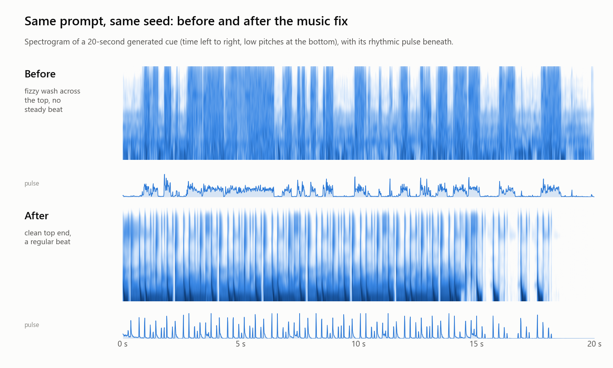
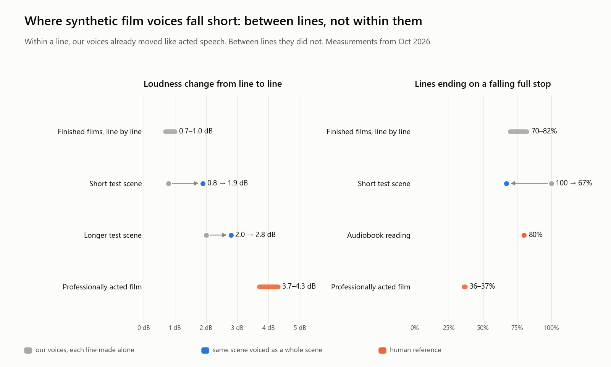
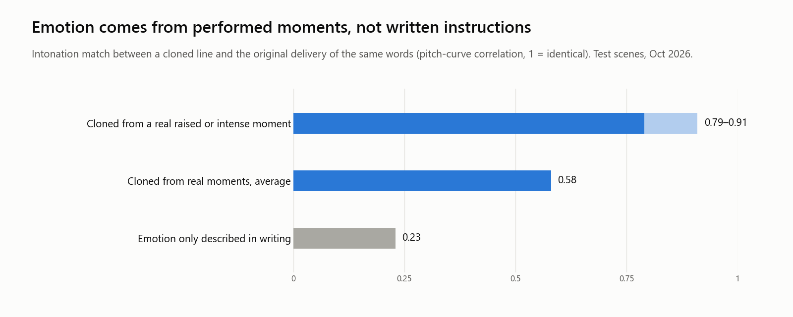
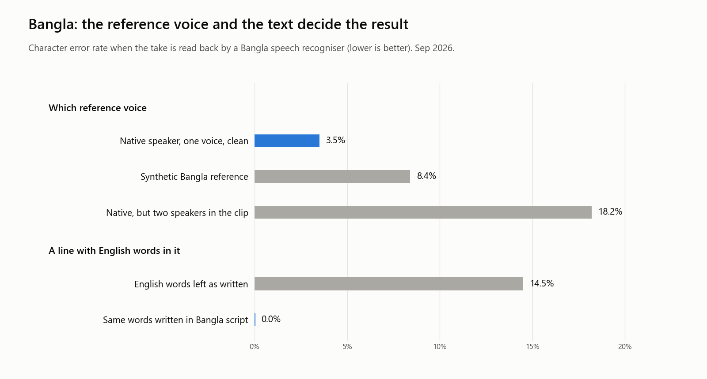
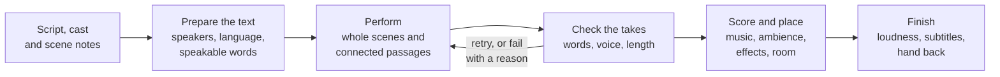

<p align="center"></p>
<p align="center"><b>Voices, music, ambience and sound effects for long-form films, made on one consumer PC.</b></p>
<p align="center">


</p>

Vox is a local engine for the sound of long-form films. It voices narrators and casts of dozens of characters, and makes the music, ambience and sound effects around them, entirely on one consumer PC with an 8 GB graphics card. It runs as a desktop studio and as the shared sound service behind the author's other film tools; this page describes what it does and what building it taught us.

> **Status:** research preview · closed source · commercial release planned

## Contents

- [Highlights](#highlights)
- [Showcase](#showcase)
- [How it works, at a glance](#how-it-works-at-a-glance)
- [Research discussion](#research-discussion)
  - [Abstract](#abstract)
  - [1. Motivation](#1-motivation)
  - [2. Research questions](#2-research-questions)
  - [3. Design principles](#3-design-principles)
  - [4. Approach](#4-approach)
  - [5. Evaluation](#5-evaluation)
  - [6. Findings and discussion](#6-findings-and-discussion)
  - [7. Limitations](#7-limitations)
  - [8. Future work](#8-future-work)
- [Roadmap](#roadmap)
- [The family](#the-family)
- [Availability](#availability)
- [Citation](#citation)
- [License](#license)

## Highlights

- **Whole films, voiced locally.** A motion-comic film of about 21 minutes was voiced end to end on the one card: 373 lines and 20 music cues, with no two voices overlapping and no line running past its shot.
- **Scenes voiced as scenes.** Dialogue is generated a scene at a time, not line by line. On test scenes, line-to-line loudness variation rose from 0.8 to 1.9 dB (and 2.0 to 2.8 dB), flat falling endings dropped from 100% to 67%, and all 11 checked lines were in the right voice.
- **Emotion from performance, not adjectives.** Clones made from real performed moments matched the original intonation at 0.58 on average and up to 0.91 for raised and intense moments. Describing the same emotion in writing scored 0.23.
- **Cloning from a scene.** From a scene of up to ten minutes, Vox separates the speakers and offers a family of checked variations of each voice, for voices the user has the right to use.
- **Bangla that holds up.** With a clean native reference, Bangla takes read back at 3.5% character error. A line mixing Bangla and English went from 14.5% to 0.0% once its English words were prepared for the voice.
- **Music, ambience, foley and breakdown.** Beds, atmospheres and effect takes from a description, plus a breakdown that takes a song or scene apart. Drum hits are found with 87–99% F1 on known-answer songs.
- **Repairs at the source.** Music that came out fizzy and beatless now keeps a steady beat from the same prompt and seed. A faint tonal buzz in generated music and effects was traced and largely removed at the source.
- **Safeguards for unattended work.** A take that never stopped used to hold the shared card for over 20 minutes; it now fails in about two and a half minutes with a readable reason.
- **Loudness that lands.** Finished mixes average 0.37 dB from their loudness target.
- **One sound service, many tools.** Comicat, Calliodus and ZipCat draw their voices, music and effects from Vox, so a voice designed once is the same character in every tool.

## Showcase

All four figures are real. Figure 1 is drawn from two generated files on disk; Figures 2 to 4 plot the dated measurements reported in [Evaluation](#5-evaluation).

<p align="center"></p>

**Figure 1. The same music cue, same prompt and same seed, before and after the October music fix.** Before, the top of the spectrum is a constant fizzy wash and the pulse strip shows no regular beat; after, the top end is clean and the beat is regular. The listener confirmed by ear that the second version "sounds better", and all three cues regenerated this way came back with a detectable beat.

<p align="center"></p>

**Figure 2. Why short tests passed and long films failed.** Within a line, our voices already moved their pitch about as much as acted speech. Between lines, loudness barely changed and most lines ended on the same falling full stop, an audiobook cadence rather than an actor's. Voicing a scene as a whole (blue) moved both measures toward acted film (orange) without closing the gap.

<p align="center"></p>

**Figure 3. Emotion has to come from performed audio.** Given a real performed moment, the clone follows its intonation; given only a written description, the delivery barely changes. These scores are on the original words. On new words a reference carried only about half of its pitch movement (see [Findings](#6-findings-and-discussion)).

<p align="center"></p>

**Figure 4. For Bangla, the reference voice and the text decide the result.** A clean recording of one native speaker had less than half the error of a synthetic reference; a native clip with two speakers was worst and leaked its own words into new takes. The voice could not read English in Latin letters, and writing the same words in Bangla script removed every error on the test line.

## How it works, at a glance



A request arrives from the studio or a companion app as a script with a cast and, optionally, notes about each scene. Vox first prepares the text: who speaks, in which language, and how every number, abbreviation or foreign word should be said. It then performs, voicing dialogue a scene at a time and narration as connected passages. Takes are checked before they are kept: were the words said, is it the right voice, did it stop when it should. A failed take is tried again or voiced another way, or the job stops with a reason; nothing plausible but wrong is passed on. Music, ambience and effects are placed around the voices, and the result is finished to a loudness target with subtitles and handed back.

One constraint shapes all of this: a single 8 GB card shared with other applications. Only one generation job holds the card at a time, models take turns, and long jobs queue rather than compete for memory.

## Research discussion

### Abstract

We describe Vox, a local system that voices long-form, many-character films and generates their music, ambience and effects on a single consumer GPU. We report what we learned producing motion-comic and illustrated-book films in English and Bangla. First, written emotional direction barely changed delivery (intonation match 0.23), while cloning from real performed moments did (0.58 on average, up to 0.91). Second, voices that pass short tests failed over long films for a measurable reason: inside a line their pitch moved like acted speech, but between lines loudness and register varied far less, and most lines ended on the same falling cadence. Voicing whole scenes together raised that variation, though not to the level of acted film. Third, for Bangla the reference voice and the text mattered more than extra compute: a clean native reference gave 3.5% character error, and preparing English words for the voice took a mixed line from 14.5% to 0.0%. Fourth, unattended generation needs safeguards that fail loudly, because the costliest failures were silent ones.

### 1. Motivation

The author's tools turn comics and public-domain books into narrated films of ten to twenty minutes or more. Each film needs a storyteller who carries about 65% of the running time and a cast that can run to dozens of characters; one film's cast had 41 designed voices. Hosted voice services charge by the minute and require scripts and voices to leave the machine; for a single creator making long films, local generation keeps the cost fixed and the material private.

The machine is an ordinary one: an 8 GB graphics card and 16 GB of memory, shared with the other tools (footage analysis, image work, editing). The question is not whether a model can speak, but whether a whole film can sound performed on hardware like this, in two languages, without a person watching every take.

Bangla adds its own problem. The Bangla voices that run locally may lean toward the Indian variety of the language, and real scripts, such as advertising copy, are full of prices, dates, abbreviations and English brand names that the voice was never taught to read.

### 2. Research questions

1. Where does believable emotion in synthetic speech come from: written direction, a reference performance, or the surrounding scene?
2. Why do voices that pass short tests fail over a long, dramatic film, and what restores the variation between lines?
3. How far can Bangladeshi Bangla be improved through reference choice and text preparation alone, without training a new voice model?
4. What safeguards does unattended, long-form generation need on one shared consumer GPU?
5. Can music, ambience and effects be generated and analysed locally to the standard a film mix needs?

### 3. Design principles

- **Measure first, then let the ear decide.** Consequential changes are tested before they are built, usually on a side-by-side or blind listening page with measurements beside each clip. Measurements reject the obviously bad; the listener has the final word. *Why:* the ear caught what measurements missed and corrected more than one first theory (Section 6).
- **Fail loudly, never plausibly.** A take that runs away, a voice that cannot be found, a finishing preset that does not exist: each must stop the job with a reason, not return something that sounds almost right. *Why:* the most expensive failures we found were silent ones.
- **Context over isolation.** Generate together what belongs together: a scene's dialogue, a storyteller's connected sentences. *Why:* a line made alone resets its pitch and falls at its full stop, and a film made of such lines sounds read, not acted.
- **One card, one job at a time.** Everything is designed around a single 8 GB GPU that other applications also need. Models take turns and long jobs queue. *Why:* the card holds only one large model at a time, and a crash halfway through a film costs more than waiting.
- **Keep the user's work.** Takes are kept with their settings; untouched material is archived but never deleted automatically, and anything a project uses is protected. Re-voicing part of a scene leaves approved lines exactly as they were. *Why:* long films are built over many sessions, and a lost approved take is a lost performance.
- **One vocabulary for every tool.** The studio and the companion apps describe voices, delivery, music and effects in the same terms. *Why:* the apps had drifted apart, each with its own names for the same sounds, and things fell between them.

### 4. Approach

Capabilities only; implementation details are not published.

**Voices and casting.** A voice can be designed from a written description, cloned from a short clip, or taken from a scene, and is kept in a library with its transcript. A film's cast is a set of library voices, one per character, plus the storyteller. Voice families group variations of one speaker (intense, raised, soft and so on) under one identity.

**Cloning from a scene.** From a scene of a recording, Vox builds a family of variations of each speaker's voice, and every variation is checked against the source before it is offered. It is designed with consent in mind: the intended uses are the user's own recordings and performers who have agreed.

**Emotional performance.** A shared vocabulary describes how each line should be performed. The calling app fills it in from the script and Vox turns it into a performance. Of the ways we tried (Section 6.3), the lesson that survived is that the performance has to come from audio, not adjectives.

**Scenes and passages.** Dialogue is voiced a scene at a time, with a handful of speakers in their own voices, and returned as individual lines that an editor can still move. Narration is voiced as connected passages, each in one take. A scene can be continued from a kept start, so approved lines stay identical. If a scene cannot be voiced, its lines are voiced one by one instead, so a film is never left silent.

**Bangla.** Bangla voices are built from native references. A text front end turns numbers, dates, currencies, abbreviations and English words into speakable Bangla, and every take is checked by reading it back.

**Music, ambience, effects and breakdown.** Music beds, atmospheres and ambiences come from a description or preset and fit any length; effects are auditioned as several takes at once. The breakdown takes a song or scene apart, re-imagines its music in other styles, builds beds from the file itself, and finds distinct hits, drum hits and the moments a beat comes back, which the editor uses to cut on the beat.

**Finishing.** A small set of finishing presets for documentary, podcast, audiobook, broadcast, trailer and similar deliveries; restoration of the top end for voices whose output is band-limited; optional breaths, room tone and pause styles; loudness to a target; and subtitles with every take, spelled from the script rather than transcribed.

### 5. Evaluation

All tests ran on the author's PC during development. Most compare two versions on the same material; ranges cover several clips, scenes or films. Listening judgments are the author's own. These are headline results from dated project notes, not a third-party benchmark, and test material is described generically.

**5.1 Voice and performance**

| Date | What was tested | Headline result |
|---|---|---|
| 2026-10-09 | Intonation of clones against the original delivery on test scenes: from a real performed moment vs. from a written emotion | 0.58 average, 0.79–0.91 on raised and intense moments, vs. 0.23 written |
| 2026-10-09 | Off-the-shelf emotion recognisers on restrained screen acting | Read it as neutral; simple acoustic measurements caught a shout both missed |
| 2026-10-09 | Repeatability of one clone take | The same clip scored 0.44 on one take and 0.78 on another |
| 2026-10-17 | Keeping a character's identity while changing emotion (3 voices, 6 states each) | Re-designing the voice "in" an emotion kept identity in at most 1 of 18 test groups; holding identity fixed and changing only the performance kept it in 18 of 18 |
| 2026-10-17 | Emotion carried by a reference onto new words | About half of the reference's pitch movement, and none of its pace or loudness |
| 2026-10-20 | Our film voices vs. professionally acted film dialogue and an audiobook reading | Pitch movement inside a line comparable (2.4–3.3 vs. 2.6–4.3 semitones). Between lines: loudness spread 0.7–1.0 vs. 3.7–4.3 dB; register 1.5–2.1 vs. 3.5 semitones (the film figure mixes several actors); falling endings 70–82% vs. 36–37% (audiobook 80%) |
| 2026-10-20 | Scene-at-a-time vs. line-at-a-time on the same scenes | Loudness spread 0.8 → 1.9 dB (short scene) and 2.0 → 2.8 dB (longer); falling endings 100% → 67% (short); 11 of 11 lines in the right voice |
| 2026-10-20 | Speed of scene-at-a-time voicing | 17.0 s of audio in 18 s (short scene); 56.8 s in 104 s (longer) |
| 2026-10-20 | End to end on a 15-scene film copy | A 15-line scene voiced 15 of 15; continuing from the middle of a scene kept the earlier lines identical |

**5.2 Bangla** (character error rate, read back by a Bangla recogniser; lower is better)

| Date | What was tested | Headline result |
|---|---|---|
| 2026-09-23 | Reference: one native speaker, clean | 3.5% |
| 2026-09-23 | Reference: synthetic Bangla from another voice | 8.4% |
| 2026-09-23 | Reference: native, but two speakers in the clip | 18.2%, and the clip's own words leaked into the take |
| 2026-09-23 | More sampling effort with the best reference | No improvement |
| 2026-09-23 | A line with English words: left in Latin letters vs. written in Bangla script | 14.5% → 0.0% |

**5.3 Music, effects and finishing**

| Date | What was tested | Headline result |
|---|---|---|
| 2026-09 | Loudness accuracy of finished voice renders, four scripts | Previously 0.8–1.8 dB under target; now within a few tenths of a dB |
| 2026-09 | Top-end restoration on band-limited voices (upper-band spectral flatness) | 0.39 → 0.63, against 0.62 for a human recording |
| 2026-09-26 | Faint tonal buzz in generated music and effects | Traced and largely removed at the source; 17 earlier files repaired |
| 2026-10-03 | Three music cues regenerated from the same prompts and seeds (Figure 1) | Before: no detectable beat and excess high-frequency fizz. After: a steady beat in all three (129, 123 and 152 BPM); confirmed by ear |
| 2026-10-29 | Drum-hit detection: 3 known-answer songs and 5 real tracks | F1 94–96% kick, 87–95% snare, 93–99% hi-hat, timing about 10 ms. "Beat comes back" moments: 4 of 4 within 12 ms, no false alarms (the editor's previous section estimates were 1.2–7.8 s off) |
| 2026-10-29 | Beat grid in the companion editor, known songs | From 26–46 ms late to 3–5 ms |
| 2026-10-29 | Loudness of finished mixes | 0.37 dB from target on average |

**5.4 Reliability and film-level audits**

| Date | What was tested | Headline result |
|---|---|---|
| 2026-10-10 | Library auto-archive, first sweep | 840 untouched items archived; every file kept on disk |
| 2026-10-13 | Runaway generation on text the voice could not read (a legal notice) | Before: one chunk ran over 20 minutes on the shared card. After: fails in about 2.5 minutes with a readable reason; a normal line still returns in 37 s |
| 2026-10-17 | A 21-minute film voiced through the service | 373 of 373 lines and 20 music cues; no overlaps, no line past its shot |
| 2026-10-29 | Audit of two finished films (about 10 and 21 minutes), voices separated from the mix | Line-to-line voice loudness 0.4–1.1 dB (median) vs. 3.7–4.3 dB in acted film; storyteller slower than the characters (3.0 vs. 3.5 and 2.7 vs. 3.2 words/s); the score hardly dipped under the storyteller; in one film 16 of 64 lines were crowded by the background, 13 of them by a vintage-style crackle in the score; no overlapping lines; separation found the voice in 99% and 95% of line time |
| 2026-11-08 | Dead air in a narrated film | Pauses inside takes up to 0.88 s (median 0.40 s), and each sound effect delayed the next line by 1.4 s; tightened |

### 6. Findings and discussion

**6.1 Emotion is performed, not instructed.** The clearest result is also the simplest. A voice told in writing to sound afraid or grave barely changes; a voice given a real performed moment follows it. Emotional depth is a question of where the performance comes from, not of better adjectives. It also changed how we judge emotion: off-the-shelf recognisers heard restrained screen acting as neutral, while simple acoustic measurements caught what they missed. We now measure delivery rather than classify it.

**6.2 Short tests hide what long films expose.** Our voices sounded good in short tests and flat across a film. The listener's verdict was blunt: fine for tests, not for a long comic with dynamic characters and emotion. Measurement located the problem. Inside a line, pitch moved as much as in acted speech. Between lines, little changed: loudness varied by a fifth to a quarter of what actors do, register by about half (although the film figure mixes several actors), and roughly three quarters of lines fell to the same full stop, the profile of an audiobook, not a drama. The cause was structural: every line was made and levelled on its own, without knowing what came before. The fix that helped most was also structural: voicing a scene as a scene, and narration as connected passages. It moved every between-line measure in the right direction, but not all the way (Figure 2).

**6.3 What did not work, and what it taught.**

- *Re-designing a voice "in" an emotion* gave strongly emotional clips from a different person almost every time. Identity and performance have to be handled separately.
- *A reference clip carries only part of its emotion to new words*: about half of its pitch movement and none of its pace or loudness. The strong intonation matches in Figure 3 were on the reference's own words.
- *Performed takes kept identity but not drama.* A route that held each character's identity fixed and changed only the performance kept identity in every test group. Yet in a finished film those lines were no more expressive than plain ones, and they made the storyteller's pace erratic: 3.70 syllables a second on average and as low as 1.85, against a steady 4.55 for plain narration. Passing a component test is not the same as improving a film.
- *Evening out the pace* was rejected before it was built. We offered the listener a page of pace choices; the reply was that the voices themselves, not their pace, were the problem. That reframing led directly to the between-line analysis in 6.2.
- *Our first theory about a music whine was wrong.* The listener said the first fix had not worked; the real cause lay elsewhere, and only the ear could confirm the second.
- *More is not always better.* Elaborate "cinematic" music direction and a strong cave reverb on voices were both turned down by ear in favour of the simpler originals.

**6.4 The reference is the voice.** For Bangla, a clean single-speaker native reference beat everything else, a synthetic reference more than doubled the error, and a two-speaker clip was worst and leaked its own words into new takes. More sampling effort did not help. Scene cloning pointed the same way: references with the music set aside cloned as well as, or better than, the original dialogue track.

**6.5 Text is half of speech.** The largest single Bangla gain came from the text, not the voice: the voice cannot read Latin letters, so English words must reach it already written in Bangla. Text also caused the runaway in 5.4, when a publisher's legal notice was queued as narration and the voice never found its end. And the measurement itself needed fixing: some Bangla letters can be encoded in two equivalent ways, and until scoring folded them together, every error figure was roughly doubled. All figures here come from after that fix.

**6.6 Silent failures cost the most.** The failures that hurt most were not crashes. A companion app sent finishing-preset names the engine did not know, and a whole cast went out with no finishing applied and no error. A status check run while the engine was stopped reported scenes as ready when they had never been voiced. Both were fixed, and an audit later found a third case, a music failure inside a render that could be swallowed and leave a voice-only result. The lesson: every fallback must be visible, and "ready" must be checked against what will actually play.

**6.7 One take is not a verdict.** Generation is noisy. The same reference gave 0.44 on one take and 0.78 on the next, and fine-grained scores swung wildly with small timing errors. Scene cloning therefore never judges a voice on a single take.

**6.8 Measure before building, and be willing not to build.** Drum-hit detection was proven on songs with known answers before any interface existed. A planned improvement to mix loudness was dropped after measurement showed mixes already landed 0.37 dB from target on average, and the improvement would only have reached 0.14 dB.

### 7. Limitations

- **The gap to acted film remains.** Scene-level voicing raised between-line variation (to 1.9–2.8 dB of loudness spread on test scenes), but acted film sits at 3.7–4.3 dB.
- **Emotion per line is not chosen automatically yet.** The performance vocabulary exists. Banks of emotional states for each voice, and a director that picks a state for every line from the page, are planned and not built.
- **Listening judgments come from one listener**, the author, not a panel. Measurements support them but do not replace them.
- **The Bangla accent question is open.** We have not yet tested by blind listening whether a Bangladeshi reference carries a Bangladeshi accent or only the voice. Accent and naturalness are judged by a native ear only. The Bangla text front end exists, but an October audit found edge cases (abbreviations and date words matched inside other words) and paths where it was not applied, so we report no accuracy figure for it.
- **A faint residue of the music buzz** remained in the quiet gaps between beats when last examined (2026-10-03).
- **Memory, not the GPU, is often the speed limit.** With little free system memory, scene voicing ran 8 to 10 times slower.
- **Model storage must be protected.** A model-cache loss showed the need for verified, restorable model storage. As of late October, some analysis features were unavailable until the affected models could be restored.
- **The engine audit is not closed.** An October audit reproduced defects including very short or silent takes breaking a render, numbers and clock times split at the wrong place, and the server pausing during heavy post-processing. We do not claim all of them are resolved.
- **One machine.** All results come from one PC; no other hardware has been tested.

### 8. Future work

- **A performance director.** Choose each line's state, strength and manner from the page itself: the lettering, the scene's mood, who is speaking to whom, and where the character is in their arc. Guard against over-acting with explicit evidence rules.
- **Storyteller registers.** Give the narrator distinct registers (hushed, grave, urgent, warm and others) for the 65% of a film it carries, and let a book's narrator "do the voices" for quoted speech, as a person reading aloud would.
- **Bangla.** A blind accent study between Bangladeshi and Indian Bengali references; pause profiles for narration, advertising, news and poetry; emphasis through Bangla's own particles rather than stress.
- **Even pacing** across a film's storyteller and cast without flattening the acting.
- **Film-level mix checks**: the score dipping under the storyteller, background texture never crowding a line, and safe peak levels on export.
- **Verified, restorable model storage** and a re-audit of the engine.

## Roadmap

**Done**

- [x] Local voice studio: design, clone, library, long-form narration, multi-speaker dialogue
- [x] Music, ambience, foley and audio breakdown on the same card
- [x] Bangla voices from native references, with Bangla read-back scoring
- [x] Clone from a scene, with voice families and checked variations
- [x] Music fizz fixed and tonal buzz largely removed at the source
- [x] Runaway-generation safeguard
- [x] Library with auto-archive that never deletes on its own
- [x] Scene-at-a-time dialogue for films, with line-by-line fallback
- [x] Drum-hit and beat-return analysis for cutting on the beat
- [x] One sound service for Comicat, Calliodus and ZipCat

**In progress**

- [ ] Narration voiced as connected passages by default in every tool
- [ ] Closing the remaining between-line gap to acted film

**Planned**

- [ ] Per-character emotional states and a performance director that reads the page
- [ ] Storyteller registers, and narrators that "do the voices" in books
- [ ] Bangladeshi accent study by blind listening
- [ ] Bangla text front end applied everywhere and cleared of known edge cases
- [ ] Even pacing across a film's storyteller and cast
- [ ] Film-level mix checks before export
- [ ] Verified, restorable model storage

## The family

Vox is the sound engine of a small family of local film tools by the same author.

| Project | What it does | Link |
|---|---|---|
|  **Vox** | Voices, music, ambience and sound effects for long-form films (this repository) | [github.com/iam-abrarx/-vox-sound](https://github.com/iam-abrarx/-vox-sound) |
| **Comicat** | Comic pages into narrated motion-comic films | [github.com/iam-abrarx/comicat](https://github.com/iam-abrarx/comicat) |
| **Calliodus** | Illustrated public-domain books into narrated films | [github.com/iam-abrarx/-Calliodus](https://github.com/iam-abrarx/-Calliodus) |
| **ZipCat** | AI film studio with vision-language footage search | [github.com/iam-abrarx/ZipCat-VL-Embedding](https://github.com/iam-abrarx/ZipCat-VL-Embedding) |
| **Daily News Kernel Studio** | An unattended local newsroom | [github.com/iam-abrarx/daily-news-kernel-studio](https://github.com/iam-abrarx/daily-news-kernel-studio) |

## Availability

Vox is closed source and not licensed for use or redistribution. For partnerships or early access, reach out through the author's GitHub profile.

## Citation

```bibtex
@misc{vox2026,
  author       = {Abrar Al Sayem},
  title        = {Vox: Local Voice and Sound for Long-Form, Many-Character Films},
  year         = {2026},
  howpublished = {\url{https://github.com/iam-abrarx/-vox-sound}}
}
```

## License

Copyright © 2026 Abrar Al Sayem. All rights reserved. See [LICENSE](LICENSE).
